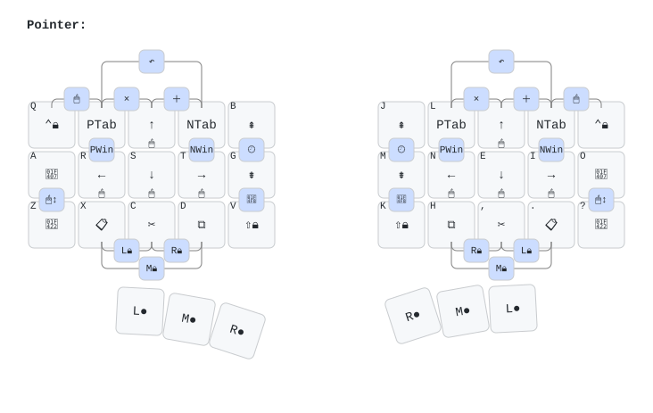

# Corne ZMK config

Personal 36-key Corne firmware for `nice_nano@2.0.0`, with separate builds for
the left and right halves. The configuration pins ZMK and its modules in
[`config/west.yml`](config/west.yml); GitHub Actions builds the targets declared
in [`build.yaml`](build.yaml).

## Keymap


The outer thumbs are Backspace on the left and Right Arrow on the right. Hold
Space for Nav, Enter for Fn, and Smart for Num. Fn and Num together activate
Sys.

## Mouse layer

Press `Q+W` from Base, Nav, or Num to enter Mouse Left, or `Y+'` to enter Mouse
Right. Only the selected hand receives mouse bindings; the other hand remains
on Base and is free for normal typing. The entry combo on the selected hand
also exits Mouse. Because entry uses `&to`, Mouse Left and Mouse Right cannot be
active together.



The Pointer diagram contains both one-hand alternatives. The same keys in
[Scroll mode](mouse-scroll.svg) scroll instead of moving the pointer.

### Keys

| Left hand | Right hand | SVG | Action |
| --- | --- | --- | --- |
| `B` / `G` | `J` / `M` | `⇞` / `⇟` | Page up / page down |
| `P` | `L` | `PTab` | Previous tab |
| `W` | `Y` | `NWin` | Alt+Tab; keeps Alt held for two seconds |
| `F` `R` `S` `T` | `U` `N` `E` `I` | `↑` `←` `↓` `→` | Move or scroll up / left / down / right |
| `A` / `Z` | `O` / `?` | `🐇` / `🐢` | Hold for 4x / 1/4x movement or scroll speed |
| `Q` / `V` | `'` / `K` | `Ctrl` / `Shift` | Tap one-shot, hold momentary, double-tap lock |
| `D` / `C` | `H` / `,` | `Copy` / `Paste` | Ctrl+C / Ctrl+V; Shift adds Ctrl+Shift |
| `X` | `.` | `L Lock` | Hold LMB until the active LMB thumb or Mouse exit |
| Active thumbs | Active thumbs | `R● M● L●` / `L● M● R●` | Right / middle / left click, mirrored by hand |

In Scroll mode, `F R S T` or `U N E I` scroll up, left, down, and right. The
speed keys apply the same 4x and 1/4x scaling to pointer movement and scrolling.
They use Mouse-specific layers, so layer keys on the free hand cannot change
pointer speed.

Ctrl and Shift support three gestures: tap for a 900 ms one-shot modifier, hold
for a normal momentary modifier, or double-tap to lock until the next
double-tap. Shift therefore changes Copy/Paste into Ctrl+Shift+C/V. Exiting
Mouse releases Ctrl, Shift, Alt, and all mouse buttons, clears every Mouse
sublayer, and returns the next entry to Pointer mode.

`W` or `Y` presses Alt+Tab and keeps Alt held for two seconds after release, so
repeated taps move through the visible window switcher. Hold the active hand's
Shift key (`V` or `K`) while tapping the window key to move backward. Any other
key or the two-second timeout releases Alt.

The LMB lock holds only left click, with no timeout. Press the active LMB thumb
or exit Mouse to release it. RMB and MMB remain ordinary thumb clicks.

### Combos

| Left hand | Right hand | SVG | Action |
| --- | --- | --- | --- |
| `Q+W` | `Y+'` | `Mouse L` / `Mouse R` | Enter the selected hand or exit it |
| `A+Z` | `O+?` | `🖱↕` | Switch Pointer / Scroll mode |
| `B+G` | `J+M` | `🕘` | Clipboard history |
| `G+V` | `M+K` | `📸` | Screen snip |

The existing Base/Nav/Num combos remain unchanged; the table above lists the
combos active on the selected Mouse hand and its Scroll/LMB-lock sublayers.
No Mouse combo contains a direction key, so pointer and scroll movement starts
without waiting for a combo timeout. Use Ctrl with PgUp/PgDn to change tabs.
Clipboard history and screen snip use the Windows shortcuts `Win+V` and
`Win+Shift+S`.

### Design rationale

- Mouse Left and Mouse Right are mirrored alternatives. Only one is active, so
  the other hand retains the Base keymap.
- `F R S T` and `U N E I` keep directions spatially oriented on their half.
  Switching to Scroll changes the behavior, not the direction map; `B G` and
  `J M` likewise provide page up/down.
- `W` and `Y` provide a timed Alt+Tab session; Shift reverses it. `P` and `L`
  retain direct previous-tab access, while Ctrl+PgUp/PgDn handles both tab
  directions.
- `A Z` and `O ?` are the fast and precise speed holds. Chording either pair
  toggles Pointer/Scroll mode, making the mode switch mnemonic without consuming
  another key.
- Copy and Paste use Ctrl+C/V so holding or locking Shift produces the terminal
  variants Ctrl+Shift+C/V. `X` and `.` are the mirrored dedicated LMB-lock
  keys.
- Mouse clicks mirror across the thumbs so the fingers can continue steering.
  Tap/hold/double-tap Ctrl and Shift support both quick shortcuts and modified
  clicking without forcing one interaction style.

## Prompt shortcuts

Hold the Enter thumb for Fn, then press:

- `B` for Abstract
- `G` for Reason
- `V` for Plan

The prompt macros type without sending Enter. Press a prompt key again while it
is typing to cancel it.

## Build

The repository's GitHub Actions workflow builds both halves from `build.yaml`.
For a local west workspace, initialize the pinned manifest first:

```sh
west init -l config
west update
west zephyr-export
```

Then build each target from the workspace root:

```sh
west build -s zmk/app -d build-left -b 'nice_nano@2.0.0//zmk' -- \
  -DSHIELD=corne_left -DZMK_CONFIG="$PWD/config" \
  -DZMK_EXTRA_MODULES="$PWD"

west build -s zmk/app -d build-right -b 'nice_nano@2.0.0//zmk' -- \
  -DSHIELD=corne_right -DZMK_CONFIG="$PWD/config" \
  -DZMK_EXTRA_MODULES="$PWD"
```

## Diagrams

The checked-in SVGs are generated with keymap-drawer 0.23.0. See
[`draw/README.md`](draw/README.md) for the source files, legend, and exact
regeneration commands.
